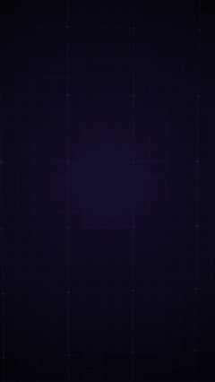

# Guia em português: app-promo-motion

<p align="center"><br><sub>Feito com o modelo neutro para um app fictício ("Budgie"), prévia sem som; o vídeo real sai com música, efeitos e narração.</sub></p>

Skill do Claude para criar vídeos de divulgação de apps em motion design profissional (vertical 9:16 para Reels, TikTok e Shorts),
feitos inteiramente em código, renderizados quadro a quadro e sincronizados com as batidas da música.

O vídeo final tem:
- texto 3D animado;
- transições em que um elemento vira o outro;
- câmera 3D contínua, com desfoque e profundidade;
- fundo quadriculado que viaja entre as telas;
- tipografia mista;
- um efeito sonoro para cada elemento;
- narração opcional.

A entrega pode ser em 1080p, 2K ou 4K.

Não há geração de vídeo por IA. A animação é código que dá para ler e mudar, usando o logo, as cores, as fontes e os prints reais do
seu app. Uma nota como "segura mais o check" vira um número alterado e um novo render.

## Instalação
No Claude Code:

```bash
git clone https://github.com/GabrielZubioli/app-promo-motion ~/.claude/skills/app-promo-motion
```

Ou baixe o repositório como zip e coloque a pasta na pasta de skills (Claude Code: `~/.claude/skills/`; claude.ai: envie como skill).

Precisa ter no computador:
- Node.js 18 ou mais novo, ffmpeg, Google Chrome (ou Chromium);
- Python 3 com `numpy` e `scipy` (`pip install numpy scipy`);
- uma placa de vídeo que o Chrome use para WebGL (qualquer notebook ou desktop comum serve).

É opcional ter uma chave da ElevenLabs ou da OpenAI para a narração e os efeitos realistas. Sem elas, dá para usar a voz gratuita
do sistema, uma gravação sua ou não ter narração.

Para conferir tudo, rode `/app-promo-motion doctor`.

## Comandos
| Comando | O que faz |
|---|---|
| `/app-promo-motion` | o fluxo completo, com paradas para você aprovar |
| `help` | lista os comandos e mostra em que etapa o projeto está |
| `doctor` | confere o computador e explica como resolver o que faltar |
| `new <pasta> --name "App"` | cria um projeto a partir do modelo neutro |
| `brief` | coleta o material do app e preenche a configuração (cores, fontes, logo, prints, recursos, música) |
| `storyboard` | propõe as cenas e as transições para aprovar |
| `music <arquivo>` | encontra o ritmo, as batidas e o drop; o logo aparece no drop |
| `build` | anima o storyboard aprovado |
| `review` | gera quadros dos momentos-chave e das transições e confere |
| `preview` | vídeo em 1080p com som, mais uma cópia leve para compartilhar |
| `sound` | efeitos sonoros ligados a cada elemento |
| `voice [provedor]` | narração: `none` (sem), `files` (suas gravações ou qualquer outra ferramenta), `system` (voz do sistema, grátis), `elevenlabs`, `openai` |
| `mix` | mixagem final (música + efeitos + narração) em −14 LUFS |
| `render 1080p\|2k\|4k` | render final, conferido quadro a quadro |
| `notes "..."` | aplica uma rodada de ajustes como uma versão nova |
| `caption [plataforma]` | escreve o texto do post para o vídeo |

## Narração: você escolhe
- **Sem narração:** só música e efeitos.
- **Suas gravações ou outra ferramenta de voz:** coloque os arquivos `t01.wav`, `t02.mp3`… na pasta `audio/vo`. Serve qualquer TTS
  (Azure, Google, Play.ht…) ou a sua própria voz.
- **Voz do sistema:** grátis e offline (Windows, macOS, Linux). Boa para aprovar texto e tempo antes de gastar créditos.
- **ElevenLabs ou OpenAI:** vozes naturais. A chave fica no arquivo `.env.local`, nunca no código nem no chat. Antes de gastar
  créditos, o Claude pergunta.

## Configurando um projeto (sem programar)
Tudo sobre o seu app fica em `video/project.js`:
- nome, frase de efeito, site e loja;
- cores, fontes e logo;
- ritmo da música (BPM) e o segundo do drop;
- palavras da intro e o tamanho de cada uma;
- prints das telas com os títulos;
- chamada final.

Abra `video/index.html` no Chrome para ver a animação ao vivo enquanto edita.

## Como funciona por dentro
- `video/index.html` desenha cada quadro num canvas. `scripts/render.mjs` controla o Chrome quadro a quadro e entrega as imagens ao ffmpeg.
- Três planos de profundidade e painéis 3D são compostos por um pequeno motor WebGL (`gl3d.js`) através de uma câmera em movimento.
- Cada acontecimento da página tem um nome (`text.title.2`, `swap.screen.3`…). O `build_cues.py` transforma esses nomes num mapa de
  sons, e o `mix.py` encaixa cada som no milissegundo certo.

## Licença
MIT (arquivo `LICENSE`): qualquer pessoa pode usar, modificar e distribuir, inclusive comercialmente, desde que mantenha o aviso de
copyright e a licença. As fontes incluídas (Inter e Kaushan Script) seguem a SIL Open Font License; veja `THIRD_PARTY_NOTICES.md`.
Música, vozes, logos e prints que você adicionar seguem as licenças deles (`references/claims-and-licensing.md`).
